# KickAss ShaderZ for Fusion Studio

v2 2026-10-16  

## Overview

&quot;KickAss ShaderZ&quot; is an open-source collection of 3D surface material shaders for the Fusion community, by the Fusion community.. Curated by Andromeda_Girl and developed for Reactor by Andrew Hazelden.

WSL forum members can submit new shaders to be added to the collection, and watch the library grow.

### For More Information

If you'd like to explore how the KickAss Shaders were created, simply expand the group to peek inside the shader.

<a href="https://www.steakunderwater.com/wesuckless/viewtopic.php?p=27949#p27949">KickAss ShaderZ</a> is a project that is hosted on the WeSuckLess Fusion community forum. You can check out the contents of this repository if you need direct access to the individual files via your web browser.

## Created by

- Andromeda_Girl
- Andrew Hazelden

## Requirements

- [Blackmagic Fusion v9.0.2 to 21.1.1+</a> or Resolve v15 to 21.1.1+](https://www.blackmagicdesign.com/support/family/davinci-resolve-and-fusion)
- [Reactor Standalone](https://github.com/Kartaverse/Reactor-Standalone) Package Manager

## Installation

The KickAss ShaderZ is installed using the Reactor package manager. Look for KickAss ShaderZ in the &quot;Shaders&quot; category on the left side of the Reactor window.

## Content Browser

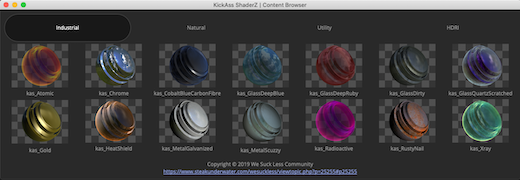

The &quot;Content Browser&quot; window allows you to effortlessly navigate through the &quot;Industrial&quot;, &quot;Natural&quot;, &quot;Utility&quot;, and &quot;HDRI&quot; categories of macros included in the KAS shader collection. This view is accessed using the &quot;KickAss ShaderZ &gt; Content Browser...&quot; menu item.

## KickAss ShaderZ Descriptions

## Industrial

### kas_Atomic

&quot;<a href="DoAction://KAS_Industrial_kas_Atomic">kas_Atomic</a>&quot; creates an irradiated material that is self-illuminated with an orange shade.

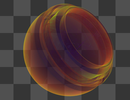

### kas_Chrome

&quot;<a href="DoAction://KAS_Industrial_kas_Chrome">kas_Chrome</a>&quot; creates a super shiny metallic surface.

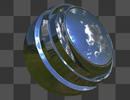

### kas_CobaltBlueCarbonFibre

&quot;<a href="DoAction://KAS_Industrial_kas_CobaltBlueCarbonFibre">kas_CobaltBlueCarbonFibre</a>&quot; is great for futuristic hard surface modelled objects where you might want a procedurally textured lightly scuffed surface for added photorealism.

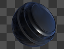

### kas_GlassDeepBlue

&quot;<a href="DoAction://KAS_Industrial_kas_GlassDeepBlue">kas_GlassDeepBlue</a>&quot; is a semi-transparent glass material. A primitive attempt has been taken to simulate a faked blue color absorption effect on the material using a Falloff node.

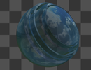

### kas_GlassDeepRuby

&quot;<a href="DoAction://KAS_Industrial_kas_GlassDeepRuby">kas_GlassRuby</a>&quot; is a semi-transparent glass material. A primitive attempt has been taken to simulate a faked red color absorption effect on the material using a Falloff node.

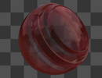

### kas_GlassDirty

&quot;<a href="DoAction://KAS_Industrial_kas_GlassDirty">kas_GlassDirty</a>&quot; creates a semi-transparent glass with a layer of grime coating the surface.

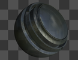

### kas_GlassQuartzScratched

&quot;<a href="DoAction://KAS_Industrial_kas_GlassQuartzScratched">kas_GlassQuartzScratched</a>&quot; is a semi-transparent glass material. A primitive attempt has been taken to simulate a faked purple color absorption effect on the material using a Falloff node.

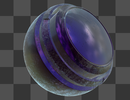

### kas_Gold

&quot;<a href="DoAction://KAS_Industrial_kas_Gold">kas_Gold</a>&quot; creates a stylized NPR metallic surface material that could be used for logos and titles. The lustre of the gold is highly dependent on the lighting angle. Make sure to enable the Fusion 3D workspace &quot;3D Options &gt; Lighting&quot; mode so you see an accurate preview of the material in the realtime viewport.

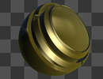

### kas_HeatShield

&quot;<a href="DoAction://KAS_Industrial_kas_HeatShield">kas_HeatShield</a>&quot; generates a super-heated plasma-like fresnel shading effect that can be used to create earth atmosphere re-entry shading effects for spacecraft or meteorites. The material can also be modified to augment the look of tracer bullets, incendiary rounds, or futuristic ballistic weaponry that need a plasma like heat bubble that wraps around the projectile.

When you render the &quot;kas_HeatShield&quot; surface material, don't forget to explore adding an exponential glow effect to the final frame to increase the incandescent luminoous feel of the material. The &quot;TextureMap&quot; input connection on the node supports images with alpha channels which can punch holes through the final material for a patch-work shading effect.

If you want to see the kas_HeatShield material with the same look as the thumbnail has, <a href="Load://Reactor:/Deploy/Comps/KickAss ShaderZ/kas_HeatShield.comp">open the provided kas_HeatShield.comp</a> file located at &quot;Reactor:/Deploy/Comps/KickAss ShaderZ/kas_HeatShield.comp&quot;. This composite has a customized Light Rotate XYZ value on the kas_ShaderBall node.

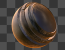

### kas_MetalGalvanized

&quot;<a href="DoAction://KAS_Industrial_kas_MetalGalvanized">kas_MetalGalvanized</a>&quot; creates an industrial sheet metal material.

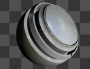

### kas_MetalScuzzy

&quot;<a href="DoAction://KAS_Industrial_kas_MetalScuzzy">kas_MetalScuzzy</a>&quot; is a metallic material that has become dulled by a thick layer of dirt and grime.

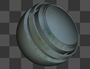

### kas_Radioactive

&quot;<a href="DoAction://KAS_Industrial_kas_Radioactive">kas_Radioactive</a>&quot; creates an irradiated material that is self-illuminated with a strong violet shade.

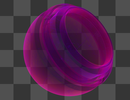

### kas_RustyNail

&quot;<a href="DoAction://KAS_Industrial_kas_RustyNail">kas_RustyNail</a>&quot; creates a worn, oxidized steel material.

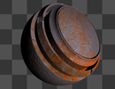

### kas_Xray

&quot;<a href="DoAction://KAS_Industrial_kas_Xray">kas_Xray</a>&quot; creates a stylized and colourful NPR rendering effect of a medical X-ray material.

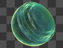

## Natural

### kas_DarkBlueIceShard

&quot;<a href="DoAction://KAS_Natural_kas_DarkBlueIceShard">kas_DarkBlueIceShard</a>&quot; creates a frosted blue icy material.

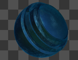

### kas_GreenEctoplasm

&quot;<a href="DoAction://KAS_Natural_kas_GreenEctoplasm">kas_GreenEctoplasm</a>&quot; is perfect for organic effects like semi-transparent gloopy liquids, or otherworldly paranormal objects.

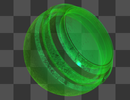

### kas_IridescentBlue

&quot;<a href="DoAction://KAS_Natural_kas_IridescentBlue">kas_IridescentBlue</a>&quot; creates a luminous material with a saturated blue sheen, and a fresnel edge shading effect.

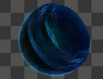

### kas_MarbleStone

&quot;<a href="DoAction://KAS_Natural_kas_MarbleStone">kas_MarbleStone</a>&quot; creates a glossy tiled floor material. You can choose to render this stone with a full surface displacement effect on the mesh.

To get the displacement effect out of this material you need to add a Displace3D node and connect its &quot;SceneInput&quot; input to a 3D model&#39;s &quot;3DData&quot; output connection. Then connect the &quot;kas_MarbleStoneDisplace&quot; node&#39;s &quot;DisplacementTextureOutput&quot; connection to the Displace3D node&#39;s &quot;Input&quot;connection. The strength of the displacement effect is controlled on the Displace3D node&#39;s scale attribute with a good starting value of approximately 0.02.

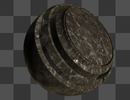

kas_MarbleStone Asset Licenses:

Freeware: 
<a href="AddMedia://Reactor:/Deploy/Macros/KickAss ShaderZ/Assets/kas_MarbleStone_Roughness.jpg">kas_MarbleStone PBR Textures</a>

By: 
<a href="https://www.textures.com">https://www.textures.com</a>

Is licensed under: 
CG Textures Freeware

Creative Commons: 
<a href="https://hdrmaps.com/freebies/st-nicolaus-church-interior">St. Nicholaus Church Interior HDRI</a>

By: 
<a href="https://hdrmaps.com">https://hdrmaps.com</a>

Is licensed under: 
<a href="https://creativecommons.org/licenses/by/2.0/">CC BY 2.0</a>

### kas_OrganicMote

&quot;<a href="DoAction://KAS_Natural_kas_OrganicMote">kas_OrganicMote</a>&quot; is perfect for stylized NPR rendering needs such as bio-medical visualization. If you are assigning this material to animated elements that are floating around and drifting slowly in your scene, make sure to enable motion blur and DoF bokeh blur in your renderings for added realism.

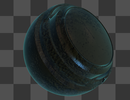

### kas_Ocean

&quot;<a href="DoAction://KAS_Natural_kas_Ocean">kas_Ocean</a>&quot; macro creates a multi-spectral ocean material that combines an HDRI environment map with a simulated sub-surface translucent like shading layer.

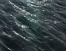

kas_Ocean Asset Licenses:

Simon's Town Rocks, Cape Town, South Africa IBL

Creative Commons: 
<a href="https://hdrihaven.com/hdri/?h=simons_town_rocks">Simon&#39;s Town Rocks</a>

By: 
<a href="https://hdrihaven.com/">https://hdrihaven.com/</a>

Is licensed under: 
<a href="https://creativecommons.org/publicdomain/zero/1.0/deed.en">CC0 (Public Domain)</a>

Anonymous Water Template

The Anonymous Water Template is the actual Fusion 3D water setup as it was used on Roland Emmerich's <a href="https://www.imdb.com/title/tt1521197/">Anonymous</a> (2011) film, courtesy of <a href="http://www.uncharted-territory.com/">Uncharted Territory</a>.

SIGGRAPH 2012 Presentation on Anonymous: 
<a href="https://www.youtube.com/watch?v=mOpN6C3ZrjY">https://www.youtube.com/watch?v=mOpN6C3ZrjY</a>

### kas_RedBloodCell

&quot;<a href="DoAction://KAS_Natural_kas_RedBloodCell">kas_RedBloodCell</a>&quot; is perfect for stylized NPR rendering needs such as bio-medical visualization of high detail blood cells flowing in a bloodstream. If you are assigning this material to animated blood cells that are floating around and drifting slowly in your scene, make sure to enable motion blur and DoF bokeh blur in your renderings for added realism.

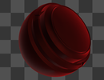

### kas_StoneWall

&quot;<a href="DoAction://KAS_Natural_kas_StoneWall">kas_StoneWall</a>&quot; creates a rough wall from fieldstone and mortar. You can choose to render this stone with a bump map, or with a full surface displacement effect on the mesh.

To get the displacement effect out of this material you need to add a Displace3D node and connect its "SceneInput" input to a 3D model&#39; s &quot;3DData&quot; output connection. Then connect the &quot;kas_StoneWall&quot; material&#39; s &quot;DisplacementTextureOutput&quot; connection to the Displace3D node&#39; s &quot;Input&quot; connection. The strength of the displacement effect is controlled on the Displace3D node&#39;s scale attribute with a good starting value of approximately 0.2.

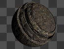

kas_MarbleStone Asset Licenses:

Freeware: 
<a href="https://quixel.com/assets/scpgdgca">kas_StoneWall PBR Textures (Castle Stone Wall)</a>

By: 
<a href="https://quixel.com/megascans">https://quixel.com/megascans</a>

Is licensed under: 
Quixel Megascans Freeware

### kas_VelvetyMoss

&quot;<a href="DoAction://KAS_Natural_kas_VelvetyMoss">kas_VelvetyMoss</a>&quot; is perfect for stylized NPR rendering organic elements such as bio-medical visualization.

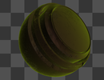

### kas_VolcanicMagma

&quot;<a href="DoAction://KAS_Natural_kas_VolcanicMagma">kas_VolcanicMagma</a>&quot; creates a super hot molten rock material. When you render this material, consider attaching a 2D glow effect to highlight the surface cracks that are luminous.

To get the displacement effect out of this material you need to add a Displace3D node and connect its "SceneInput" input to a 3D model&#39; s &quot;3DData&quot; output connection. Then connect the &quot;kas_VolcanicMagma&quot; material&#39; s &quot;DisplacementTextureOutput&quot; connection to the Displace3D node&#39; s &quot;Input&quot; connection. The strength of the displacement effect is controlled on the Displace3D node&#39;s scale attribute with a good starting value of approximately 0.2.

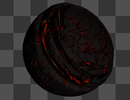

## Utility

### kas_IconSaver

&quot;<a href="DoAction://KAS_Utility_IconSaverNode">kas_IconSaver</a>&quot; renders a Fusion v9 Bin window 130x100 px BMP format icon to the Comp PathMap folder. If you have HiQ enabled simply viewing this node will write you new bin icon to disk.

This node is supposed to be connected directly to the &quot;kas_ShaderBall.Output&quot; node&#39;s output connection.

The kas_IconSaver node includes an integrated copy of the GreyCheckerboard macro. GreyCheckerboard is based upon the "Checkerboard" macro from the <a href="https://www.musevfx.com/tools/">Muse Tools Library</a> by Joe Laude.

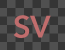

### kas_GreyCheckerboard

&quot;<a href="DoAction://KAS_Utility_GreyCheckerboardNode">kas_GreyCheckerboard</a>&quot; renders a preview shader swatch with a baked in grey checker background.

GreyCheckerboard is based upon the "Checkerboard" macro from the <a href="https://www.musevfx.com/tools/">Muse Tools Library</a> by Joe Laude.

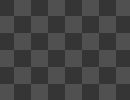

### kas_ShaderBall

&quot;<a href="DoAction://KAS_Utility_ShaderBallNode">kas_ShaderBall</a>&quot; adds a shader ball model to your Fusion 3D system scene. It is used to apply and preview the look of surface materials. Make sure to enable the Fusion 3D workspace &quot;3D Options &gt; Lighting&quot; mode so you see an accurate preview of the material in the realtime viewport.

This node&#39;s output is supposed to be connected directly to the &quot;kas_ShaderPreview&quot; nodes input connection so you can see a high-quality preview of your surface material.

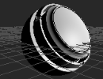

### kas_ShaderBallDragon

&quot;<a href="DoAction://KAS_Utility_ShaderBallDragonNode">kas_ShaderBallDragon</a>&quot; adds a Stanford Dragon model shader ball to your Fusion 3D system scene. It is used to apply and preview the look of surface materials. Make sure to enable the Fusion 3D workspace &quot;3D Options &gt; Lighting&quot; mode so you see an accurate preview of the material in the realtime viewport.

This node&#39;s output is supposed to be connected directly to the &quot;kas_ShaderPreview&quot; nodes input connection so you can see a high-quality preview of your surface material.

The &quot;DragonUVMap3D&quot; node inside the GroupOperator allows you to adjust the UV layout on the model and its perfect for tweaking how the texture map is placed on the mode.

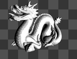

kas_ShaderBallDragon Asset License:

By: 
<a href="https://graphics.stanford.edu/data/3Dscanrep/">The Stanford 3D Scanning Repository</a>

Is licensed under: 
Public Domain

### kas_ShaderPreview

&quot;<a href="DoAction://KAS_Utility_ShaderPreviewNode">kas_ShaderPreview</a>&quot; is has a Renderer3D node inside is that renders a preview shader swatch with a baked-in grey checker background.

This node is supposed to be connected directly to the &quot;kas_ShaderBall.Output&quot; node&#39;s output connection.

The kas_ShaderPreview node includes an integrated copy of the GreyCheckerboard macro. GreyCheckerboard is based upon the &quot;Checkerboard&quot; macro from the <a href="https://www.musevfx.com/tools/">Muse Tools Library</a> by Joe Laude.

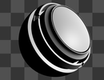

## HDRI

### kas_Parkland

&quot;<a href="DoAction://KAS_HDRI_kas_Parkland">kas_Parkland</a>&quot; is an HDRI image of Egg mountain in Gory Sowie, Poland. The foreground of the image has a grassy field with smooth rolling mountains stretching upwards in the distance.

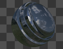

### kas_SimonsTownRocks

&quot;<a href="DoAction://KAS_HDRI_kas_SimonsTownRocks">kas_SimonsTownRocks</a>&quot; is an HDRI image of a rocky coastal shoreline in Simon&#39;s Town, Cape Town, South Africa.

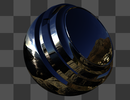

### kas_StNicholasChurch

&quot;<a href="DoAction://KAS_HDRI_kas_StNicholasChurch">kas_StNicholasChurch</a>&quot; is an HDRI image of the interior of the Domincian order&#39;s St. Nicholas Church in Gdańsk, Poland. The church was originally errected in 1227. The interior of the church currently features a baroque altar design with a black and golden coloured theme.

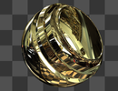

## Copyright Credits

## kas_Parkland

Creative Commons: 
<a href="https://hdrmaps.com/freebies/egg-mountain-at-afternoon">Egg mountain at afternoon</a>

By: 
<a href="https://hdrmaps.com">https://hdrmaps.com</a>

Is licensed under: 
<a href="https://creativecommons.org/licenses/by/2.0/">CC BY 2.0</a>

## Simon's Town Rocks, Cape Town, South Africa IBL

Creative Commons: 
<a href="https://hdrihaven.com/hdri/?h=simons_town_rocks">Simon&#39;s Town Rocks</a>

By: 
<a href="https://hdrihaven.com/">https://hdrihaven.com/</a>

Is licensed under: 
<a href="https://creativecommons.org/publicdomain/zero/1.0/deed.en">CC0 (Public Domain)</a>

## St. Nicholas Church, Gdansk, Poland IBL

Creative Commons: 
<a href="https://hdrmaps.com/freebies/st-nicolaus-church-interior">St. Nicolaus Church Interior HDRI</a>

By: 
<a href="https://hdrmaps.com">https://hdrmaps.com</a>

Is licensed under: 
<a href="https://creativecommons.org/licenses/by/2.0/">CC BY 2.0</a>

## kas_StoneWall

Freeware: 
<a href="https://quixel.com/assets/scpgdgca">kas_StoneWall PBR Textures (Castle Stone Wall)</a>

By: 
<a href="https://quixel.com/megascans">https://quixel.com/megascans</a>

Is licensed under: 
Quixel Megascans Freeware

## kas_MarbleStone

Freeware: 
<a href="AddMedia://Reactor:/Deploy/Macros/KickAss ShaderZ/Assets/kas_MarbleStone_Roughness.jpg">kas_MarbleStone PBR Textures</a>

By: 
<a href="https://www.textures.com">https://www.textures.com</a>

Is licensed under:  
CG Textures Freeware  

## Anonymous Water Template

The Anonymous Water Template is the actual Fusion 3D water setup as it was used on Roland Emmerich's <a href="https://www.imdb.com/title/tt1521197/">Anonymous</a> (2011) film, courtesy of <a href="http://www.uncharted-territory.com/">Uncharted Territory</a>.

SIGGRAPH 2012 Presentation on Anonymous: 
<a href="https://www.youtube.com/watch?v=mOpN6C3ZrjY">https://www.youtube.com/watch?v=mOpN6C3ZrjY</a>

## GreyCheckerboard

GreyCheckerboard is based upon the "Checkerboard" macro from the <a href="https://www.musevfx.com/tools/">Muse Tools Library</a> by Joe Laude.

## kas_ShaderBallDragon Asset License:

By: 
<a href="https://graphics.stanford.edu/data/3Dscanrep/">The Stanford 3D Scanning Repository</a>

Is licensed under: 
Public Domain

## ShaderZ Texture Inputs

There are two image input connections on most of the ShaderZ material nodes named &quot;TextureMap&quot; and &quot;EnvironmentMap&quot;.

The &quot;TextureMap&quot; input connection allows you to supply your own imagery that will be applied as the base texture map. The &quot;EnvironmentMap&quot; input connection allows you to supply your own spherical environment image that will be visible as the reflected environment for the material.

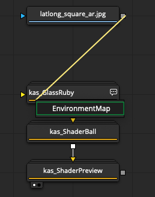

Note: <i>When imagery is connected to these inputs they are automatically activated and used inside the material via a pair of SwitchElse.fuse nodes that are packed inside the shader. The second you disconnect your imagery from the input connections the surface material defaults back to the internal default texture maps.</i>

## Fusion Effects Tab

In Fusion Studio Standalone v16 you can access the KickAss ShaderZ by open up the &quot;Effects&quot; Tab. Then expand the &quot;Templates &gt; KickAss ShaderZ &gt; Native ShaderZ &gt;&quot; section. You can now select between a &quot;Industrial&quot;, &quot;Natural&quot;, and &quot;Utility&quot; set of surface materials.

You can drag/drop any of the items in this Templates list into your Nodes view and they will be instantly added to your composite.

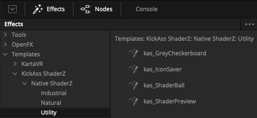

<strong>Note:</strong> <em>Try to make sure to drag the nodes to an open space in the Nodes view so the new material's node-based content doesn't co-mingle with your existing node graph and cause the content to pile up in an unsightly &quot;heap of nodes&quot;. If this issue ever happens to you, all you have to do to rectify the situation is to hit the &quot;Edit &gt; Undo &gt; &quot; menu item to remove the most recently added nodes from the comp.</em>

## Fusion Select Tool

Pressing the &quot;Shift + Spacebar&quot; hotkey when Fusion&#39;s Nodes view is in focus will display a &quot;Select Tool&quot; dialog. Typing in &quot;kas_&quot; is a quick way to filter the list of available nodes down to the content provided by the &quot;KickAss ShaderZ&quot; collection.

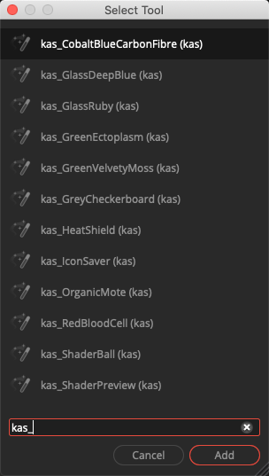

## KickAss ShaderZ Menu

The &quot;KickAss ShaderZ&quot;root level menu system in Fusion Studio provides a quick way to access the full shader collection and the shader tools.

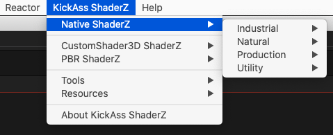

The KAS menu layout consists of the following entries:

KickAss ShaderZ &gt;

<ul>
<li>Native ShaderZ &gt;
<ul>

<li>HDRI &gt;
<ul>
<li><a href="DoAction://KAS_HDRI_kas_Parkland">kas_Parkland</a></li>
<li><a href="DoAction://KAS_HDRI_kas_SimonsTownRocks">kas_SimonsTownRocks</a></li>
<li><a href="DoAction://KAS_HDRI_kas_StNicholasChurch">kas_StNicholasChurch</a></li>
</ul>
</li>

<li>Natural &gt;
<ul>
<li><a href="DoAction://KAS_Natural_kas_DarkBlueIceShard">kas_DarkBlueIceShard</a></li>
<li><a href="DoAction://KAS_Natural_kas_GreenEctoplasm">kas_GreenEctoplasm</a></li>
<li><a href="DoAction://KAS_Natural_kas_IridescentBlue">kas_IridescentBlue</a></li>
<li><a href="DoAction://KAS_Natural_kas_MarbleStone">kas_MarbleStone</a></li>
<li><a href="DoAction://KAS_Natural_kas_OrganicMote">kas_OrganicMote</a></li>
<li><a href="DoAction://KAS_Natural_kas_Ocean">kas_Ocean</a></li>
<li><a href="DoAction://KAS_Natural_kas_RedBloodCell">kas_RedBloodCell</a></li>
<li><a href="DoAction://KAS_Natural_kas_StoneWall">kas_StoneWall</a></li>
<li><a href="DoAction://KAS_Natural_kas_VelvetyMoss">kas_VelvetyMoss</a></li>
<li><a href="DoAction://KAS_Natural_kas_VolcanicMagma">kas_VolcanicMagma</a></li>
</ul>
</li>

<li>Industrial &gt;
<ul>
<li><a href="DoAction://KAS_Industrial_kas_Atomic">kas_Atomic</a></li>
<li><a href="DoAction://KAS_Industrial_kas_Chrome">kas_Chrome</a></li>
<li><a href="DoAction://KAS_Industrial_kas_CobaltBlueCarbonFibre">kas_CobaltBlueCarbonFibre</a></li>
<li><a href="DoAction://KAS_Industrial_kas_GlassDeepBlue">kas_GlassDeepBlue</a></li>
<li><a href="DoAction://KAS_Industrial_kas_GlassDeepRuby">kas_GlassDeepRuby</a></li>
<li><a href="DoAction://KAS_Industrial_kas_GlassDirty">kas_GlassDirty</a></li>
<li><a href="DoAction://KAS_Industrial_kas_GlassQuartzScratched">kas_GlassQuartzScratched</a></li>
<li><a href="DoAction://KAS_Industrial_kas_Gold">kas_Gold</a></li>
<li><a href="DoAction://KAS_Industrial_kas_HeatShield">kas_HeatShield</a></li>
<li><a href="DoAction://KAS_Industrial_kas_MetalGalvanized">kas_MetalGalvanized</a></li>
<li><a href="DoAction://KAS_Industrial_kas_MetalScuzzy">kas_MetalScuzzy</a></li>
<li><a href="DoAction://KAS_Industrial_kas_Radioactive">kas_Radioactive</a></li>
<li><a href="DoAction://KAS_Industrial_kas_RustyNail">kas_RustyNail</a></li>
<li><a href="DoAction://KAS_Industrial_kas_Xray">kas_Xray</a></li>
</ul>
</li>

<li>Production
<ul>
<li><a href="DoAction://KAS_dot_dot_dot">...</a></li>
</ul>
</li>

<li>Utilty &gt;
<ul>
<li><a href="DoAction://KAS_Utility_IconSaverNode">kas_IconSaver</a></li>
<li><a href="DoAction://KAS_Utility_GreyCheckerboardNode">kas_GreyCheckerboard</a></li>
<li><a href="DoAction://KAS_Utility_ShaderBallNode">kas_ShaderBall</a></li>
<li><a href="DoAction://KAS_Utility_ShaderBallDragonNode">kas_ShaderBallDragon</a></li>
<li><a href="DoAction://KAS_Utility_ShaderPreviewNode">kas_ShaderPreview</a></li>
</ul>

</li>
</ul>
</li>

<li>CustomShader3D ShaderZ &gt;
<ul>
<li><a href="DoAction://InstallCustomShader3D">Install the CustomShader3D Plugin</a></li>
<li><a href="DoAction://KAS_dot_dot_dot">...</a></li>
</ul>
</li>
<li>PBR ShaderZ &gt;
<ul>
<li><a href="DoAction://KAS_dot_dot_dot">...</a></li>
</ul>
</li>

<li>Tools &gt;
<ul>
<li><a href="DoAction://KAS_Docs_Folder">Show KAS Docs</a></li>
<li><a href="DoAction://KAS_Macros_Folder">Show KAS Macros Folder</a></li>
<li><a href="DoAction://KAS_Comps_Folder">Show KAS Comps Folder</a></li>
<li><a href="DoAction://KAS_Config_Folder">Show KAS Config Folder</a></li>
<li><a href="DoAction://KAS_SaveSelectionToMacro">Save Selection to Macro<a/></li>
<li><a href="DoAction://KAS_PackageShaderZForReactor">Package ShaderZ for Reactor...<a/></li>
</ul>
</li>

<li>Resources &gt;
<ul>
<li><a href="DoAction://KAS_WSL_Discussion">KAS Documentation</a></li>
<li><a href="DoAction://KAS_HTML_Documentation">KAS WSL Discussion</a></li>
</ul>

</li>
<li><a href="DoAction://KAS_Browser">Content Browser...</a></li>
<li><a href="DoAction://KAS_About">About KickAss ShaderZ...</a></li>

</ul>

# KAS Tools

## Save Selection to Macro

The &quot;KickAss ShaderZ &gt; Tools &gt; Save Selection to Macro&quot; menu item exports the active Nodes view selection to a new Fusion &quot;Macros&quot; PathMap based &quot;.setting&quot; file on disk. This makes it a lot easier for comp artists to create and save out their own macros with less effort.

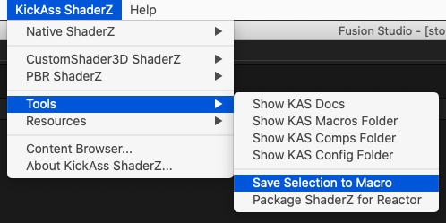

When you run the &quot;Save Selection to Macro&quot; menu item, a file save dialog appears. You can then type in a name for your new macro &quot;.setting&quot; file and choose a folder location where you want the macro saved to.

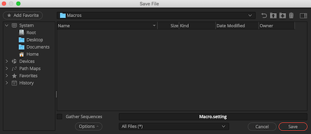

Whatever nodes are selected in the Nodes view are then instantly exported and pushed out to this new macro .setting file. Your newly saved macro is then opened up in the external script editor that is defined in the Fusion Preferences &quot;Global and Default Settings &gt; Script &gt; Editor Path&quot; section.

By opening up the macro file in an external text edior like Notepad++ (Windows)/BBEdit(macOS)/Gedit(Linux) it is possible to add the final polish like adding a CutomData HelpPage entry, or renaming the input and output connections.

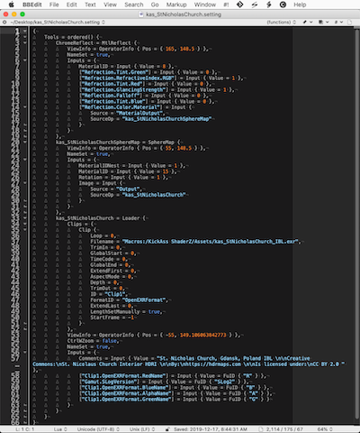

